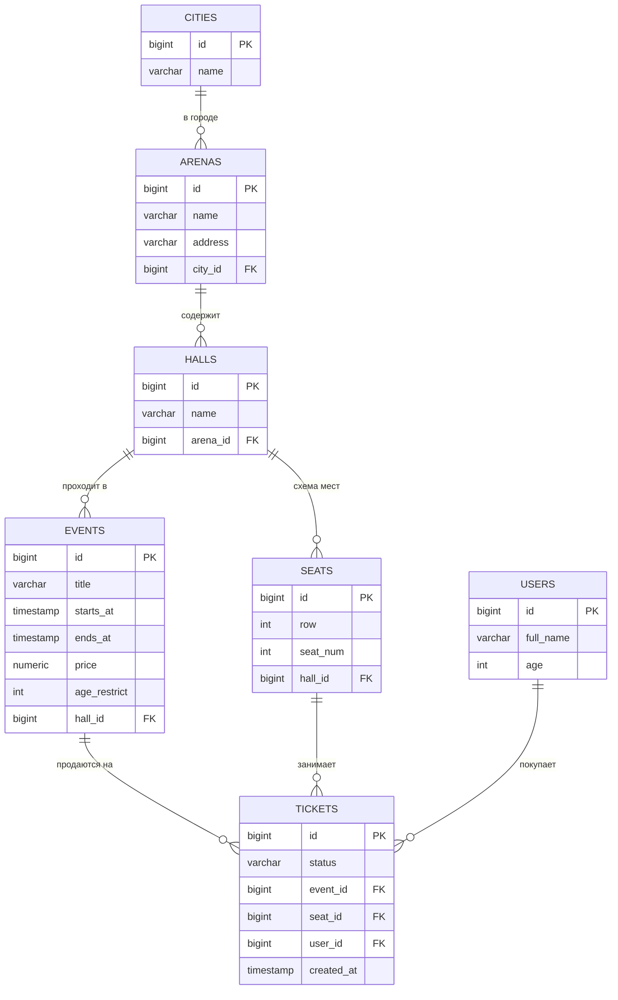
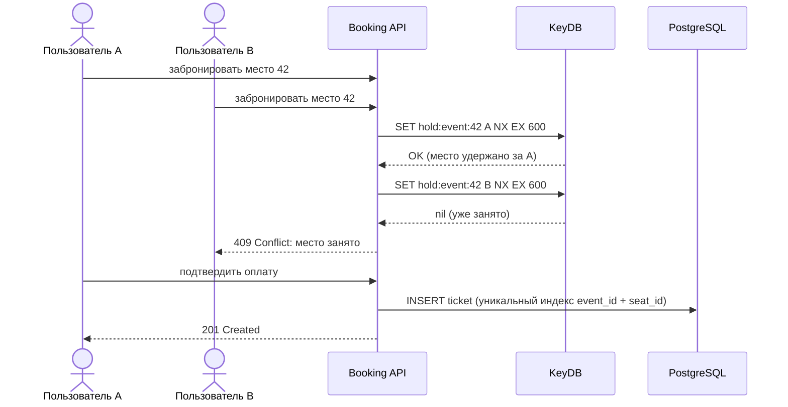
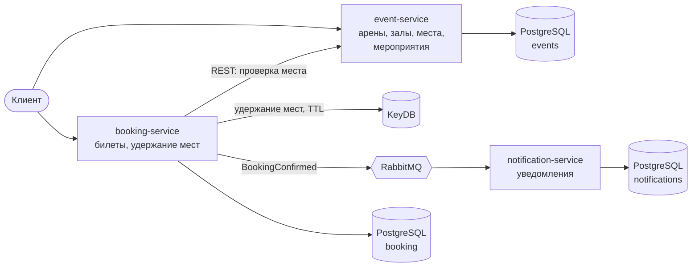

<div align="center">

# 🎫 BookingApp

**Backend-сервис для бронирования мест на мероприятия: арены, залы, схема мест и билеты**


</div>

---

## О проекте

Пользователь выбирает мероприятие, видит схему зала со свободными и занятыми местами и бронирует конкретное место. Главная инженерная задача проекта: **не допустить, чтобы одно место на одно мероприятие продали дважды**, даже если два человека нажали «Купить» в одну и ту же секунду.

Проект развивается поэтапно: от монолита на Spring Boot до микросервисов с кэшем и очередью сообщений. Прогресс по этапам отмечен в разделе [Roadmap](#-roadmap).

**Что здесь можно посмотреть:**

- проектирование реляционной схемы и версионирование БД через миграции;
- слоистую архитектуру Spring Boot: controller → service → repository, DTO, валидация;
- работу с транзакциями и конкурентным доступом к данным *(этап 2)*;
- кэширование и временное удержание мест в KeyDB *(этап 3)*;
- микросервисы и асинхронное взаимодействие через RabbitMQ *(этап 4)*.

---

## Стек

| Область | Технологии | Статус |
|---|---|:---:|
| Язык и платформа | Java 17, Spring Boot 4, Maven | ✅ |
| Web и API | Spring Web MVC, Bean Validation, springdoc-openapi (Swagger UI) | ✅ |
| Данные | PostgreSQL 17, Spring Data JPA (Hibernate), Flyway | ✅ |
| Инфраструктура | Docker, Docker Compose | ✅ |
| Тесты | JUnit 5, Mockito, Testcontainers | ⏳ |
| Кэш и удержание мест | KeyDB (Redis-совместимый), Spring Cache | ⏳ |
| Очереди сообщений | RabbitMQ, Spring AMQP | ⏳ |
| Микросервисы | REST между сервисами, отдельная БД на сервис, Spring Boot Actuator | ⏳ |

✅ уже в проекте · ⏳ запланировано

---

## Модель данных



**Логика:** город → арены → залы → места. Мероприятие проходит в конкретном зале, поэтому на него доступны места именно этого зала. Билет связывает мероприятие, место и пользователя.

Схема создаётся только миграциями Flyway (`src/main/resources/db/migration`), Hibernate её лишь проверяет (`ddl-auto: validate`).

---

## Как защищено двойное бронирование *(этапы 2-3)*



1. **Уникальный индекс в PostgreSQL** на пару «мероприятие + место» для активных билетов: база физически не даст создать второй билет на то же место.
2. **Удержание места в KeyDB** атомарной командой `SET NX EX`: место «держится» за покупателем 10 минут и освобождается само, если оплату не подтвердили.
3. **Тест конкурентности:** 10 потоков одновременно бронируют одно место, успешной должна быть ровно одна бронь.

---

## Целевая архитектура *(этап 4)*



- **Синхронно (REST):** booking-service проверяет в event-service, что место существует и относится к залу мероприятия.
- **Асинхронно (RabbitMQ):** после подтверждения брони публикуется событие. Сервис уведомлений обрабатывает его независимо, и если он недоступен, бронирование всё равно работает, а сообщения дождутся его в очереди.
- **Своя база у каждого сервиса:** сервисы не лезут в чужие таблицы напрямую.

---

## Структура проекта

```
BookingApp/
├── docker-compose.yaml              # PostgreSQL для локальной разработки
├── pom.xml
└── src/
    ├── main/
    │   ├── java/ru/my/projects/booking/
    │   │   ├── BookingApplication.java
    │   │   ├── arena/      ⏳ города, арены, залы
    │   │   ├── event/      ⏳ мероприятия, схема мест
    │   │   ├── ticket/     ⏳ бронирование и билеты
    │   │   └── common/     ⏳ обработка ошибок, конфигурация
    │   │       (внутри фич: controller / service / repository / dto / entity)
    │   └── resources/
    │       ├── application.yml
    │       └── db/migration/
    │           └── V1__create_tables.sql
    └── test/java/ru/my/projects/booking/
```

---

## Запуск

**Нужно:** JDK 17+, Docker.

```bash
# 1. Поднять PostgreSQL (порт 5000 на хосте)
docker compose up -d

# 2. Запустить приложение (Flyway сам применит миграции)
./mvnw spring-boot:run        # Windows: mvnw.cmd spring-boot:run
```

| Что | Адрес |
|---|---|
| API | http://localhost:8080 |
| Swagger UI | http://localhost:8080/swagger-ui.html |
| PostgreSQL | `localhost:5000`, БД `booking_db` |

---

## API *(планируется)*

| Метод | Эндпоинт | Описание | Статус |
|---|---|---|:---:|
| `GET / POST` | `/api/cities` | Города | ⏳ |
| `GET / POST / PUT / DELETE` | `/api/arenas` | Арены | ⏳ |
| `POST` | `/api/arenas/{id}/halls` | Создать зал сразу со схемой мест (ряды × места) | ⏳ |
| `GET / POST / PUT / DELETE` | `/api/events` | Мероприятия, фильтры по городу, арене и дате, пагинация | ⏳ |
| `GET` | `/api/events/{id}/seats` | Карта мест: свободно / занято | ⏳ |
| `POST` | `/api/tickets` | Забронировать место | ⏳ |
| `POST` | `/api/tickets/{id}/confirm` | Подтвердить бронь | ⏳ |
| `POST` | `/api/tickets/{id}/cancel` | Отменить бронь | ⏳ |
| `GET` | `/api/tickets/my` | Мои билеты | ⏳ |

Ответы об ошибках в едином формате: `400` ошибка валидации, `404` не найдено, `409` место уже занято.

---

## 🗺 Roadmap

### Этап 0. Подготовка
- [x] Проект на Spring Boot (Web MVC, Data JPA, Validation, Flyway, PostgreSQL)
- [x] PostgreSQL в Docker Compose
- [x] Первая миграция Flyway со схемой БД
- [x] `ddl-auto: validate`, `open-in-view: false`
- [x] Подключен Swagger (springdoc-openapi)
- [x] README с описанием проекта и планом

### Этап 1. Каталог
- [ ] Entity для городов, арен, залов, мест и мероприятий, связи `@ManyToOne(fetch = LAZY)`
- [ ] CRUD-эндпоинты, наружу только DTO
- [ ] Создание зала сразу со схемой мест
- [ ] Валидация входных данных (`@Valid`, Bean Validation)
- [ ] Единый формат ошибок через `@RestControllerAdvice`
- [ ] Пагинация и фильтры для мероприятий
- [ ] Карта мест мероприятия (JOIN мест и билетов)
- [ ] Unit-тесты сервисов (JUnit 5, Mockito)

### Этап 2. Бронирование
- [ ] Жизненный цикл билета: бронь → подтверждение → отмена
- [ ] Уникальный индекс против двойной брони, ошибка `409`
- [ ] Транзакции (`@Transactional`) и автоматическое снятие неоплаченных броней
- [ ] «Мои билеты» одним запросом без N+1 (JOIN FETCH / DTO-проекция)
- [ ] Тест конкурентности: 10 потоков на одно место, успешна одна бронь
- [ ] Интеграционные тесты на Testcontainers

### Этап 3. KeyDB
- [ ] Удержание места на 10 минут (`SET NX EX`)
- [ ] Кэш списка мероприятий (`@Cacheable` / `@CacheEvict`)

### Этап 4. Микросервисы
- [ ] Разделение на event-service, booking-service, notification-service
- [ ] Отдельная БД у каждого сервиса
- [ ] Событие `BookingConfirmed` через RabbitMQ
- [ ] Идемпотентная обработка сообщений
- [ ] Вся система запускается одной командой `docker compose up`
- [ ] Health-check через Spring Boot Actuator

### Этап 5. Дополнительно
- [ ] Spring Security + JWT, роли USER / ADMIN
- [ ] API Gateway
- [ ] CI на GitHub Actions: сборка и тесты на каждый push

---

<div align="center">

**Автор:** Иван Широковских · [GitHub](https://github.com/QWQ916) · shirok2005@icloud.com

</div>
